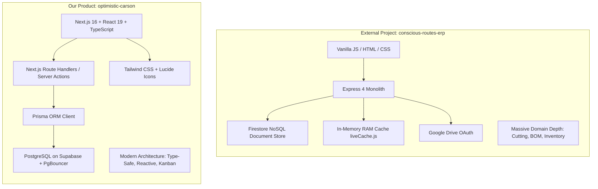

# Deep Architectural Audit & Comparative Analysis: Conscious Routes ERP vs. Modern Next.js ERP

**Audited External Project:** `conscious-routes-erp-Utsav_091026`  
**Reference Modern Project:** `optimistic-carson` (Next.js 16 + TypeScript + Tailwind + Prisma / PostgreSQL)  
**Author:** Antigravity AI Engineering Assistant  
**Date:** October 12, 2026  

---

## 1. Executive Summary

The audited repository (`conscious-routes-erp-Utsav_091026`) represents a massive, 4-month collaborative effort (July–October 2026) between a non-technical furniture manufacturing business owner (Utsav, d'furn / Conscious Routes) and **Claude Code**. 

Over dozens of iterative prompting sessions, Claude Code successfully implemented an extraordinarily deep manufacturing domain model for d'furn:
- A custom 2D Guillotine & 1D Linear Cutting-Stock Optimizer (`optimizerEngine.js`, 172 KB frontend).
- A 5-step full-screen Product Configuration Workspace (Process Chart → BOM → Part Mapping → Packing List → Costing).
- An event-sourced, append-only Raw Material inventory ledger with negative-stock prevention and physical audit tracking.
- Complete Purchase (PO + GRN / Material Inward + Vendors) and Outbound Material Issue systems.
- Production Job Orders with 3 parallel status tracks (BOM, Procurement, Production) and BOQ line revisions.
- Kiosk TV Dashboards, Machinery registers, and HRM Attendance tracking.

**However, because it was constructed incrementally by a non-technical owner using an LLM without an overarching software architect, the codebase suffers from severe architectural fragility:**
1. **The "Zero-Framework / No Build Step" Trap:** Built with Vanilla HTML/JS/CSS and Express 4. Without TypeScript, React, or a bundler, the project developed massive global state pollution, DOM focus-loss bugs on typing, 40+ un-scoped CSS stylesheets, and thousands of lines of copy-pasted boilerplate.
2. **Database Mismatch (Firestore for Relational ERP):** Using Google Firestore (a document NoSQL store) for deeply relational ERP data caused severe query billing explosions (burning 7,000 reads per picker click against a 50,000/day free cap), 90-second server hangs due to un-indexed queries, and forced the creation of dangerous in-memory RAM caches (`liveCache.js`) that break under multi-server horizontal scaling.
3. **Flaky Third-Party Integrations:** Relying on personal Google Drive OAuth for file storage resulted in uploads breaking every 7 days due to token expiration, and unhandled async rejections in Express 4 caused whole-server freezes.
4. **Fragile UI Hacks:** Double-clicks on slow network requests forced the developer to monkey-patch `window.fetch` globally to block the entire screen with a loader on every non-GET request.

In contrast, our product (`optimistic-carson`) was architected on **Next.js 16 (App Router), TypeScript, Tailwind CSS, and Prisma ORM on PostgreSQL (Supabase)**. Our solution offers compile-time type safety, transactional relational data integrity, clean reactive UI components (Kanban drag-and-drop, modals), and instant serverless scalability on Vercel.

This audit provides a file-by-file breakdown of the external codebase, catalogues every bug and bottleneck, evaluates Claude Code's attempted fixes, and outlines how to safely port their advanced manufacturing domain features into our modern architecture.

---

## 2. Tech Stack & Architecture Comparison Matrix

| Dimension | External Project (`conscious-routes-erp-Utsav_091026`) | Our Product (`optimistic-carson`) | Architectural Verdict |
| :--- | :--- | :--- | :--- |
| **Language** | Vanilla JavaScript (CommonJS on backend, browser IIFEs on frontend) | TypeScript (Strict mode enabled end-to-end) | **Our Product Wins.** Plain JS in a 100+ file ERP led to silent property typos (`item.code` vs `item.itemCode`), undefined field crashes, and zero refactoring safety. |
| **Frontend Architecture** | Multi-page static HTML (`/pages/**/*.html`) + Vanilla DOM (`innerHTML`) | Next.js 16 App Router (React Server & Client Components) | **Our Product Wins.** Vanilla DOM string interpolation creates XSS vulnerabilities, cursor focus loss on typing, and massive DOM-sync boilerplate. |
| **Styling & Design System** | 40+ handcrafted CSS files (`shell.css`, `wizard.css`, `theme.css`, `cutting.css`) | Tailwind CSS utility-first framework | **Our Product Wins.** External CSS has un-scoped global class collisions and brittle z-index wars (z-index 500, 1500, 2000, 3000, 3100). |
| **Backend & Routing** | Monolithic Node.js + Express 4.19 server | Next.js 16 Route Handlers (`/api/...`) | **Our Product Wins.** Express 4 lacks native async error handling, requiring monkey-patched router wrappers to prevent server hangs. |
| **Database Engine** | Google Firestore (NoSQL Document Store) with local JSON file fallback | PostgreSQL (Supabase with PgBouncer connection pooling) | **Our Product Wins.** ERPs are inherently relational (foreign keys, joins, cascading deletes). Firestore forced in-memory filtering, manual joins, and fragile RAM caching. |
| **Data Access / ORM** | Custom Repository pattern wrapping Google Cloud Firestore SDK | Prisma ORM (`prisma-client-js`) | **Our Product Wins.** Prisma provides type-safe queries, schema migrations, foreign key constraints, and connection pooling. |
| **File Storage** | Google Drive API (OAuth user consent, flat naming convention) | Cloud Blob / Base64 JSON storage | **Tie / Tradeoff.** Google Drive integration avoids hosting storage fees but suffers from 7-day token expiration and rate limits. |
| **Deployment & Scaling** | Monolithic Node server on Render.com | Serverless / Edge on Vercel + Managed Supabase | **Our Product Wins.** Render requires maintaining persistent state; Vercel provides automatic global edge distribution with zero maintenance. |
| **Domain Depth (Manufacturing)** | Highly Advanced (2D Guillotine nesting, 5-stage BOM workspace, Event-sourced inventory, GRN, Job Orders) | Sales & CRM Focus (Clients, Enquiries Kanban, Quotations RBAC approval) | **External Project Wins.** The external project has captured 4 months of factory floor domain nuances that must be migrated. |

---

## 3. Deep-Dive File-by-File & Subsystem Breakdown

### 3.1 Backend Infrastructure & Shared Core

#### `backend/server.js`
- **Threadpool Configuration (`UV_THREADPOOL_SIZE=16`):** Placed as line 12 before imports. Because native `bcrypt` runs on libuv's worker threadpool, the default pool size of 4 caused 20 simultaneous user logins to queue up for 17.7 seconds. Setting it to 16 dropped concurrency wait times to 4.2 seconds.
- **Trust Proxy (`app.set('trust proxy', 1')`):** Necessary for Render/reverse-proxies to prevent dropping the `Secure` flag on cookies and corrupting IP rate limiters.
- **Async Error Monkey-Patching (`installAsyncErrorForwarding`):** Express 4 does not natively catch rejected promises returned from `async` route handlers. Uncaught rejections caused requests to hang indefinitely. This function wraps all Express router layer methods to pass errors to `next(err)`.
- **Route-specific Body Parser Hack:** `/api/v1/cutting` is mounted *ahead* of the global `express.json()` parser with a custom 2 MB limit because 2,000-row cutting lists exceed the default 100 KB limit.

#### `backend/shared/dataStore.js`, `firestoreStore.js`, and `jsonStore.js`
- **Dual-Storage Abstraction:** Automatically switches between local synchronous JSON files (`data/*.json`) and Firestore based on `FIREBASE_PROJECT_ID`.
- **Custom Firestore Adapter (`firestoreStore.js`):**
  - Uses client-minted `crypto.randomUUID()` as document IDs instead of Firestore auto-IDs to maintain foreign key consistency.
  - Stores timestamps as ISO strings rather than Firestore `Timestamp` objects to prevent serialization breaking `res.json()`.
  - Implements `findWhere(companyId, field, value)` without `orderBy` to avoid requiring Google Cloud composite indexes.
  - Implements `increment(companyId, id, startAt)` inside Firestore transactions for atomic sequence numbers.

#### `backend/shared/liveCache.js` (RAM Database Cache)
- **Design:** Because reading 7,000 raw material records burned 7,000 Firestore reads per page load (exhausting the 50,000 free daily quota in 7 clicks), this module keeps the entire collection in server RAM (`Map`).
- **Sync Logic:** Checks for updates using `findChangedSince` every 60 seconds with a 5-minute overlap window.
- **Critical Flaw:** If the backend is scaled horizontally across multiple instances (e.g. Render auto-scaling or serverless), writes on Instance A do not propagate to Instance B until the polling interval triggers, and record deletions on Instance A are **never visible on Instance B until the 24-hour full reload or server reboot!**

#### `backend/shared/sequence.js`
- Generates sequential human-readable document IDs (e.g., `DF_CL_000001`, `Job 2026-27/0001`).
- Replaced an earlier dangerous pattern where the code scanned the entire database for `max(id) + 1`, which caused duplicate code collisions during concurrent requests.

---

### 3.2 Product Hierarchy, BOM & Product Workspace

#### `backend/modules/products/` & `backend/shared/bomService.js` (58 KB)
- **Hierarchy:** 5 levels: Segment → Category → Sub-category → Master Product → Variant.
- **BOM Structure (5 Sections):**
  1. `assembly`: Assembly parts (mandatory L, W, H dimensions, sourcing: in-house/outsourced, technical drawing upload) with 1 level of sub-assembly (`PartCode-S01`).
  2. `cat_<id>`: Category-specific sections dynamically filtered by matching product departments.
  3. `shopFloor`: Hardware attached on the factory floor.
  4. `packing`: Cartons, boxes, and packing materials.
  5. `siteFit`: Hardware packed for on-site installation.
- **Derived PVC Edge Banding:** The BOM automatically calculates edge-banding strip requirements by reading board dimensions and thickness, grouping them by thickness × width × shade, and auto-matching them to inventory raw materials.
- **Part Mapping:** Allocates raw materials and hardware to specific assembly parts. Includes a live names-and-quantities tree display (`LiveTree`).
- **Packing List (`backend/shared/packingListService.js`):** Defines boxes with dimensions and materials (3-ply, 5-ply corrugated) and maps assembly parts into boxes. Automatically computes volume in cubic meters (CBM) and inches.

#### `backend/shared/costingService.js`
- Computes complete unit economics for product variants:
  - Material Cost (BOM quantities × purchase rates + category wastage %).
  - Labor Cost (per-unit assembly rate).
  - Energy Cost (batch energy cost ÷ MOQ).
  - Overheads (% of production cost).
  - Sales Commission (% of selling price).
  - Gross Margin (% against base selling price).

---

### 3.3 The Cutting-Stock Optimizer

#### `backend/modules/cutting/engine/optimizerEngine.js` (40 KB) & `frontend/assets/js/cutting.js` (172 KB)
- **Zero-Dependency Heuristic Solver:** Pure JavaScript 2D Guillotine cutting stock optimizer for panel saws, beam saws, and sheet shears.
- **Capabilities:**
  - Coordinates aligned with grain direction (`length` along X, `width` along Y).
  - Cut stages tracking (rip vs. cross cuts, max 3 stages for beam saw feasibility).
  - Blade kerf compensation (e.g. 3.2 mm saw blade width) and trim margins.
  - Multi-start stochastic search using Mulberry32 PRNG with time-limit budgeting.
  - Offcut consolidation (maximizes large reusable remnants by penalizing fragmented scraps).
  - 1D Linear cutting optimizer for pipes and profiles (`linearEngine.js`).
- **Frontend Renderer (`cuttingPatternRenderer.js`):** Draws interactive SVG/Canvas cutting patterns showing board layouts, cut lines, part labels, and offcut zones.

---

### 3.4 Inventory, Purchase & Material Management

#### `backend/modules/inventory/` (Raw Materials & Stock Ledger)
- **Event-Sourced Ledger (`materialMovementService.js`):** Current book stock is never stored as a writable number; it is calculated by aggregating append-only movement records (`Purchase Receipt`, `Production Issue`, `Adjustment`, `Return`).
- **Strict Negative Stock Prohibition:** Any transaction that causes `balanceAfter < 0` is rejected with an HTTP 409 conflict.
- **Physical Audit Deviations (`stockAuditRepository.js`):** Periodic physical counts record variances against book stock without overwriting the ledger; deviations > 5% flag warning badges.

#### `backend/modules/purchase/` (PO & Goods Receipt Notes)
- Complete purchase lifecycle: Vendor directory → Purchase Order → Goods Receipt Note (GRN / Material Inward).
- Material Inward automatically writes back the latest procured unit cost to raw material records and posts `Purchase Receipt` movements to the stock ledger.

#### `backend/modules/inventory/services/materialIssueService.js`
- Outbound warehouse material issue slips issued against Job Orders, with reconciliation tracking planned vs. issued quantities.

---

### 3.5 Sales, Quotations & Production Job Orders

#### `backend/modules/sales/` (Enquiry & Quote)
- **Funnel Model:** `stage` (New → Qualified → Quoted → Converted) acts as a high-water mark that never demotes, while `outcome` (Open / Lost) tracks deal status.
- **Versioned Quotations (`quoteService.js`):** Quotes store an immutable array of `versions[]`. Any modification generates a new version (`v1`, `v2`) while preserving historical versions.
- **Approval Gate:** Quotes require verification and admin approval before a PDF can be sent to the client.

#### `backend/modules/production/` (Job Orders)
- **6-Step Creation Wizard:** Origin → Client → Commercial → Confirmation → Products → Terms.
- **3 Parallel Status Tracks:**
  1. `bomStatus`: Manual (Pending, In Progress, Completed).
  2. `procurementStatus`: Derived dynamically from Purchase Orders (read-only).
  3. `productionStatus`: Manual shop-floor indicator.
- **Multi-Currency:** Stores billing currency (INR, USD, AED, etc.) and exchange rate per order.
- **BOQ Line Versioning:** Revisions are tracked per product line rather than per whole job document.

---

## 4. Analysis of Inconsistencies, Errors & Anti-Patterns

### 4.1 Architectural Flaws
1. **Unchecked Global Scope Pollution:** The frontend relies entirely on global browser variables (`Shell`, `UI`, `Enquiries`, `Quotes`, `MaterialPicker`, `api`, `escapeHtml`). If two scripts declare the same variable or if a script fails to load, the entire page breaks with no error boundaries.
2. **Missing Compile-Time Type Checking:** A typo like `req.body.salesPersonId` vs `req.body.salespersonId` silently passes into the database as `undefined`, requiring constant manual debugging.
3. **Dual Data-Store Code Divergence:** Maintaining both `jsonStore.js` and `firestoreStore.js` created subtle discrepancies (e.g. `undefined` properties caused Firestore writes to crash with a 500 error while local JSON dropped them silently).
4. **Fragile In-Memory Caching:** `liveCache.js` stores active collections in process memory. If the application runs on multiple server instances, edits made on one instance are invisible to others for up to 60 seconds, and deletions require a full server restart to take effect.
5. **Partial RBAC Gating:** While Sales has 23 strictly enforced action permissions, the entire rest of the application (Job Orders, Inventory, Machinery, Purchase, HRM) has **zero route-level permission checks**—any authenticated user can mutate manufacturing data.

### 4.2 Runtime Logic Bugs & Edge Cases
1. **DOM Cursor Focus Loss:** Every time a user typed in a form, calling `render()` replaced the active `<input>` element, causing the cursor to drop after a single keystroke. Claude Code had to repeatedly apply patches across 5 different modules.
2. **Weekly File Upload Outages:** Using a Google Drive OAuth refresh token while the Google Cloud project was in "Testing" mode caused the token to expire every 7 days, causing file uploads to fail on production every week.
3. **Rigid Negative Stock Rejection:** Refusing negative stock sounds theoretically clean, but in a real factory, unrecorded opening balances caused valid issue slips to be completely blocked, halting shop-floor operations.
4. **Oversized JSON Payload Crashes:** Uploading large 2,000-row cutting lists exceeded the default 100 KB Express body limit, throwing unhandled 413 Payload Too Large HTML error pages.

### 4.3 Security Vulnerabilities
1. **XSS via `innerHTML` Concatenation:** Over 50 frontend files construct UI using template literals (`container.innerHTML = '
' + item.name + '
'`). A single forgotten `escapeHtml()` call allows stored Cross-Site Scripting.
2. **Browser-Only Document Generation:** Generating PDFs via `@media print` in the browser prevents server-side document verification, automated emailing, and tamper-proof archival.

---

## 5. Bottlenecks & Evaluation of Attempted Solutions

### Bottleneck 1: Firestore Read Quota Exhaustion (50,000 reads/day)
- **The Issue:** The Material Picker read the entire raw materials collection (~7,000 documents) and filtered in memory using `.filter()`, consuming 7,000 reads per click. The daily free quota was depleted in under 10 clicks.
- **Claude Code's Solution:** Implemented `findWhere()` using native Firestore equality filters and built `liveCache.js` (an in-memory RAM cache).
- **Evaluation:** `findWhere()` was the correct fix. However, `liveCache.js` is a fragile hack that breaks multi-instance horizontal scaling and consumes server RAM. In PostgreSQL, this problem does not exist: indexed queries (`SELECT * FROM "RawMaterial" WHERE "subCategoryId" = $1`) take < 2ms without billing quotas.

### Bottleneck 2: Firestore Composite Index Server Hangs
- **The Issue:** Querying `.where('companyId', '==', cid).orderBy('createdAt')` required pre-configured composite indexes in Google Cloud. When missing, Firestore threw `FAILED_PRECONDITION`, which Express 4 failed to catch, causing requests to hang for 90+ seconds.
- **Claude Code's Solution:** Created `installAsyncErrorForwarding()` to intercept unhandled promise rejections and changed queries to `findAllUnordered()`, sorting in Node.js memory.
- **Evaluation:** Error forwarding was a necessary patch for Express 4. However, sorting large datasets in Node.js memory wastes CPU. Relational SQL databases handle indexing and sorting natively.

### Bottleneck 3: Bcrypt Concurrency Bottleneck during Logins
- **The Issue:** Native `bcrypt` hashes passwords on the libuv threadpool (default size: 4). When 20 employees logged in simultaneously, requests queued up for 17.7 seconds.
- **Claude Code's Solution:** Set `process.env.UV_THREADPOOL_SIZE = '16'` as line 12 of `server.js`, lowered salt rounds from 12 to 10, and updated the rate limiter to track failed attempts only.
- **Evaluation:** **Excellent engineering.** This was a correct and insightful optimization.

### Bottleneck 4: Double-Click Form Submissions on Slow Networks
- **The Issue:** When deployed on Render with free-tier latency, users double-clicked save buttons, creating duplicate records.
- **Claude Code's Solution:** Monkey-patched `window.fetch` inside `apiClient.js` to automatically display a full-screen `UI.busy()` overlay on every non-GET request.
- **Evaluation:** Functional as a global safety net, but poor UX compared to button-level pending states (`disabled={isSaving}`) and optimistic UI updates.

---

## 6. Detailed Comparison: Their Product vs. Our Product

### Architectural Strengths of Our Product:
1. **Type Safety & Maintainability:** TypeScript guarantees that schema changes in Prisma immediately update frontend component props. Typos and undefined errors are caught during compilation, not in production.
2. **True Relational Integrity:** PostgreSQL enforces foreign key constraints (`ON DELETE CASCADE`), indexes, and atomic ACID transactions. No artificial read quotas or missing composite index crashes.
3. **Superior UX & Responsiveness:** React's virtual DOM prevents input focus loss entirely. Tailwind provides consistent design tokens, and our interactive Kanban board delivers a fluid drag-and-drop experience.
4. **Serverless Deployment:** Deployed on Vercel with automatic edge routing and zero server maintenance, eliminating Render cold starts.

### Domain Strengths of the External Project (To Be Adopted):
1. **Cutting-Stock Optimization:** The standalone 2D Guillotine and 1D Linear engine (`optimizerEngine.js`) is an incredible piece of mathematical software that saves real material costs in panel manufacturing.
2. **Manufacturing Configuration Workspace:** The 5-stage setup pipeline (Process Chart → BOM → Part Mapping → Packing List → Costing) provides complete digital manufacturing coverage.
3. **Event-Sourced Stock Ledger:** Deriving book stock from an immutable movement ledger prevents inventory tampering and provides an audit trail.
4. **Job Order Lifecycle:** The 3 parallel tracking status lines (BOM, Procurement, Production) reflect actual shop-floor realities where procurement runs in parallel with fabrication.

---

## 7. Migration & Convergence Roadmap

To build the definitive ERP for d'furn, we recommend porting the manufacturing domain intelligence from the external project into our modern Next.js/Prisma architecture according to the following phased roadmap:

### Phase 1: Database Schema Expansion in Prisma
Add the domain models from the external project into our `prisma/schema.prisma`:
- `RawMaterialCategory`, `RawMaterialSubCategory`, `RawMaterial`.
- `MaterialMovement` (event-sourced ledger: `type`, `quantity`, `balanceAfter`, `referenceId`).
- `ProductProcessChart` and `Machinery`.
- `BillOfMaterials`, `BomAssemblyPart`, `BomLine`, `BomPartMapping`, `PackingBox`.
- `JobOrder`, `JobOrderBoqLine`, `PurchaseOrder`, `GoodsReceiptNote`, `MaterialIssueSlip`.

### Phase 2: Porting the Cutting Optimizer Engine
- Copy `optimizerEngine.js` and `linearEngine.js` directly into our TypeScript project under `src/lib/cutting/`.
- Add TypeScript interfaces for inputs (`StockSheet[]`, `CutPart[]`, `CuttingConfig`) and outputs (`CuttingPlanResult`).
- Wrap execution in a Next.js API route (`POST /api/cutting/optimize`).
- Port the SVG cutting pattern visualizer into a clean React component (`<CuttingLayoutViewer />`).

### Phase 3: React Product Configuration Workspace
- Replace the 58 KB Vanilla JS `bomService.js` and `productWorkspace.js` with modular React components:
  - `<ProcessChartEditor />`
  - `<BomAssemblyEditor />` (hierarchical parts + sub-parts)
  - `<PartMappingBoard />` (drag-and-drop allocation)
  - `<PackingListCartons />` (box dimension calculator)
  - `<VariantCostingCard />` (unit-economics breakdown with Tailwind styling)

### Phase 4: Job Orders & Inventory Ledger Integration
- Implement the 6-step Job Order wizard using React Hook Form and Zod validation.
- Implement the 3 parallel status tracks (`bomStatus`, `procurementStatus`, `productionStatus`).
- Implement the append-only stock movement ledger inside atomic Prisma database transactions (`prisma.$transaction`).
- Replace browser print stylesheets with server-side PDF generation using `@react-pdf/renderer` or Puppeteer.

---

## 8. Conclusion

The external project (`conscious-routes-erp-Utsav_091026`) is a remarkable proof of what a domain expert and Claude Code can assemble, capturing deep manufacturing nuances that standard off-the-shelf ERPs miss. However, its foundation (Vanilla JS, Express 4, Firestore, Google Drive) has reached its architectural limit, suffering from frequent breaking changes, security risks, and scaling bottlenecks.

Our modern platform (`optimistic-carson`) provides the exact enterprise-grade architecture needed: **Next.js 16, TypeScript, Tailwind, and PostgreSQL**. 

By bringing their cutting algorithms, BOM structures, and inventory ledgers into our typed, relational architecture, d'furn will possess a world-class, bulletproof ERP ready for enterprise scale.
