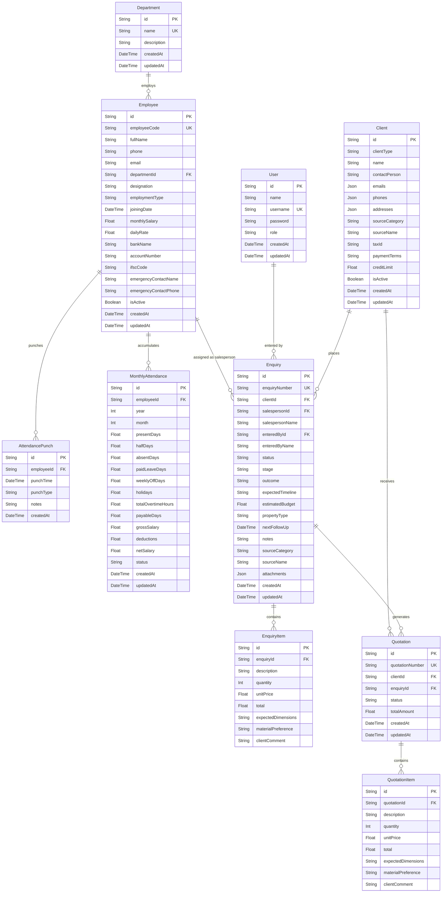
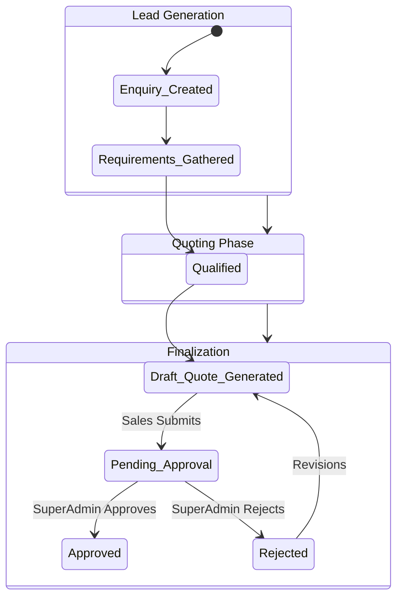

# ERP-DFurn: Complete System Documentation (V2)

## 1. Project Overview
**ERP-DFurn** is a specialized Enterprise Resource Planning (ERP) platform built for manufacturing and sales (specifically designed with furniture/cabinet manufacturing in mind). 
**Target Users**: Sales Representatives, Managers, and Super Admins.
**Problem Solved**: Centralizing client management, streamlining the sales pipeline (from lead to converted order), standardizing quotation generation, and enforcing rigorous approval workflows to prevent unauthorized discounts or unapproved specs.

### What is Built So Far:
- **Authentication & RBAC**: Database-backed user session management with `SUPER_ADMIN` and `SALES` roles, setting `auth_token`, `user_role`, `user_name`, and `user_id` session cookies with Next.js edge middleware enforcement.
- **Client Management**: Creation and tracking of B2B (`BUSINESS`) and B2C (`INDIVIDUAL`) clients, including multiple contacts and addresses.
- **Enquiries (CRM/Kanban)**: A visual pipeline for managing sales leads, synchronized with live HRM active sales representatives, automated stage/outcome tracking, client quick-add, and quotation creation triggers.
- **HRM (Human Resource Management)**: Complete employee directory with department categorization, employee codes (`HR-0001`), salary structures (monthly/daily wages), biometric daily punch logging (in/out punches, auto-hours/overtime calculation), and monthly muster roll registers.
- **Quotations (Approval Engine)**: Generation of financial quotes sequentially numbered (`DF_QT_000001`), linked directly to Enquiries (`enquiryId`), retaining line-item specifications (`expectedDimensions`, `materialPreference`, `clientComment`), and strict role-based approval flows.
- **Audit Trails**: Visual, timestamped timelines for Enquiries, Quotations, and HRM Attendance.

*(Note: The requested "Catalog / customizable cabinet sample product" module does not currently exist as a standalone feature in the codebase or database schema. It has been marked for future implementation.)*

---

## 2. Tech Stack and Architecture

**Tech Stack**:
- **Frontend**: Next.js 14 (App Router), React, Tailwind CSS, Lucide Icons. (Chosen for SSR performance, rapid UI development, and component modularity).
- **Backend/API**: Next.js Route Handlers (`/api/...`). (Chosen for seamless full-stack monorepo architecture).
- **Database**: PostgreSQL hosted on **Supabase**.
- **ORM**: Prisma (Chosen for type-safe database queries and automated migrations).
- **Bundler**: Turbopack (Chosen for ultra-fast local HMR and compile times).
- **Deployment**: Vercel (Frontend & Serverless APIs) + Supabase (DB).

### System Architecture Diagram

```mermaid
flowchart TD
    Browser[Client Browser]
    
    subgraph Vercel [Vercel Deployment]
        UI[Next.js React Client Components]
        API[Next.js Serverless Route Handlers]
        PrismaClient[Prisma Client (Node.js)]
    end
    
    subgraph Supabase [Supabase Infrastructure]
        Postgres[(PostgreSQL Database)]
        PgBouncer[Connection Pooler]
    end
    
    Browser <-->|HTTP/JSON| UI
    UI <-->|Fetch API| API
    API <-->|Local Invocation| PrismaClient
    PrismaClient <-->|TCP (Port 6543)| PgBouncer
    PgBouncer <--> Postgres
```
**Speed Choices**:
- **Connection Pooling**: Supabase provides PgBouncer (usually on port 6543) which is critical for Serverless environments (like Vercel) where thousands of ephemeral lambdas might otherwise exhaust the DB connections.
- **Optimistic UI**: Client components use React state to immediately reflect changes (like Kanban drag-and-drop) before the API confirms the write, making the app feel instantaneous.

---

## 3. Authentication and Roles

Authentication is backed by the database `User` table (handled via `POST /api/auth/login`).
Access and sessions are enforced:
- **Session Cookies**:
  - `auth_token`: HTTP-only session token (`token-${user.id}`) validated by Edge Middleware (`src/middleware.ts`).
  - `user_role`: User privilege level (`SUPER_ADMIN`, `SALES`, etc.).
  - `user_name`: Display name of the logged-in user.
  - `user_id`: Database UUID of the authenticated user, automatically linked to `Enquiry.enteredById`.
- **Edge Middleware**: Blocks unauthenticated access across all dashboard and API routes, redirecting unauthenticated requests to `/login`.
- **UI Level**: Components read the `userRole` and conditionally render privileges (e.g., hiding "Approve Quotation" for Sales reps).
- **API Level**: Endpoints enforce role and permission checks before mutating records.

### Permissions Table

| Feature / Action | `SALES` Role | `SUPER_ADMIN` Role |
| :--- | :--- | :--- |
| **Login** | Yes | Yes |
| **View Clients** | Yes (Own / All depending on scope) | Yes (All) |
| **Create Enquiries** | Yes (Assigns HRM sales reps) | Yes |
| **Move Kanban Cards**| Yes | Yes |
| **Create Quotes** | Yes (Status: `DRAFT`) | Yes |
| **Submit for Approval**| Yes | Yes |
| **Approve Quotes** | No | Yes |
| **HRM & Attendance** | Read-Only / Self | Full Access (Create/Edit/Muster) |

---

## 4. Database (In Full Detail)

### 4.1 Complete Entity-Relationship (ER) Diagram



### 4.2 Table Dictionary

#### `User`
Manages application authentication and system users.
- `id`: UUID (PK)
- `name`: String
- `username`: String (Unique, Indexed)
- `password`: String (Stored securely)
- `role`: String (`SUPER_ADMIN`, `SALES`)

#### `Department`
Organizational units within the manufacturing unit.
- `id`: UUID (PK)
- `name`: String (Unique, e.g. "Office & Sales", "Carpentry", "Edge Banding", "Assembly")
- `description`: String

#### `Employee`
HR master record for office staff, sales representatives, and factory technicians.
- `id`: UUID (PK)
- `employeeCode`: String (Unique sequential, e.g. "HR-0001")
- `fullName`: String (Required)
- `departmentId`: UUID (FK to Department, optional)
- `designation`: String (e.g. "Sales Executive", "Master Carpenter")
- `employmentType`: String (`FULL_TIME`, `DAILY_WAGER`, `CONTRACT`, `PART_TIME`)
- `monthlySalary` / `dailyRate`: Wage rates for payroll computation
- `bankName`, `accountNumber`, `ifscCode`: Financial disbursement details
- `isActive`: Boolean (Default: `true`)

#### `AttendancePunch` & `MonthlyAttendance`
Biometric / daily attendance records and aggregated monthly payroll registers.
- `AttendancePunch`: Timestamped `IN` / `OUT` punch events per employee with auto-calculated duration.
- `MonthlyAttendance`: Aggregated days (present, half-day, absent, leaves, overtime hours) and calculated net salary.

#### `Client`
Stores B2B (`BUSINESS`) and B2C (`INDIVIDUAL`) client profiles.
- `id`: UUID (PK)
- `clientType`: String (`BUSINESS` or `INDIVIDUAL`)
- `name`: String (Required)
- `emails`, `phones`, `addresses`: JSON arrays for multi-contact mapping
- `taxId`: String (e.g., GSTIN)
- `creditLimit`: Float (Default: 0.00)

#### `Enquiry`
The core CRM lead record, linked relationally to both HRM sales staff and entered users.
- `id`: UUID (PK)
- `enquiryNumber`: String (Unique auto-generated sequential ID like `DF_ENQ_000001`)
- `clientId`: UUID (FK to Client)
- `salespersonId`: UUID (FK to Employee — dynamic HRM sales rep link)
- `enteredById`: UUID (FK to User — tracks who created the lead)
- `status`: String (`NEW`, `IN_PROGRESS`, `QUALIFIED`, `DROPPED`, `CONVERTED`), kept in sync with `stage`
- `stage`: String (`New`, `Contacted`, `Site Visit Scheduled`, `Quoted`, `Follow-up`)
- `estimatedBudget`: Float
- `createdAt` / `updatedAt`: DateTime (Drives the Audit Log timeline)

#### `EnquiryItem`
Line items for an enquiry.
- `enquiryId`: UUID (FK to Enquiry, `onDelete: Cascade`)
- `expectedDimensions`: String (e.g. "1200x600x750mm")
- `materialPreference`: String (e.g. "Action TESA HDHMR, 1mm Merino Laminate")
- `clientComment`: String

#### `Quotation` & `QuotationItem`
Financial projection based on Enquiries.
- `quotationNumber`: String (Auto-generated sequential ID: `DF_QT_000001`)
- `enquiryId`: UUID (FK to Enquiry, relational cross-module linkage)
- `status`: String (`DRAFT`, `PENDING_APPROVAL`, `APPROVED`, `REJECTED`)
- `totalAmount`: Float (Calculated sum of child items)
- `QuotationItem`: Line items with full specifications matching Enquiry (`expectedDimensions`, `materialPreference`, `clientComment`)

---

## 5. Every Feature (Chronological Build Order)

### 5.1 Clients Module
- **Purpose**: Directory of all potential and active buyers.
- **Workflow**: User visits `/clients`, clicks "New Client", fills out name, type (`BUSINESS` / `INDIVIDUAL`), and JSON contact arrays.
- **Components**: `src/app/(dashboard)/clients/page.tsx`
- **API**: `GET /api/clients`, `POST /api/clients`

### 5.2 Enquiries (Kanban CRM)
- **Purpose**: Visual tracking of sales leads with dynamic HRM salesperson integration.
- **Workflow**: 
  1. Click "+ New Enquiry".
  2. Dynamically select Assigned Rep from active HRM staff fetched from `/api/hrm/employees?status=active`.
  3. Creator is automatically attached via `user_id` session cookie.
  4. Move cards across stages; `status` and `stage` remain synchronized.
  5. Click card to view details, linked quotations, or click "+ Create Quote for Lead" to jump directly into Quotations with pre-filled enquiry data.
- **Components**: `src/app/(dashboard)/enquiries/page.tsx`
- **API**: `GET /api/enquiries`, `POST /api/enquiries`, `PUT /api/enquiries/[id]`

### 5.3 Quotations (Approval Engine)
- **Purpose**: Financial proposal generation with strict oversight and sequential numbering.
- **Workflow**:
  1. Triggered from an Enquiry clicking "+ Create Quote for Lead" (passes `?enquiryId=...`), or manually created.
  2. Sequential ID `DF_QT_000001` is assigned automatically.
  3. Preserves line-item dimensions, material preferences, and comments.
  4. Status starts as `DRAFT`. Rep clicks "Submit for Approval".
  5. SuperAdmin logs in, views `PENDING_APPROVAL` quote, clicks "Approve Quotation".
- **Components**: `src/app/(dashboard)/quotations/page.tsx`
- **API**: `GET /api/quotations`, `POST /api/quotations`, `PUT /api/quotations/[id]`

### 5.4 HRM (Human Resource Management) & Attendance
- **Purpose**: End-to-end workforce management for sales representatives and factory staff.
- **Workflows**:
  1. **Employee Master (`/hrm/employees`)**: Register employees with codes (`HR-0001`), departments, salary types, bank accounts, and active status.
  2. **Daily Attendance (`/hrm/attendance`)**: Log biometric punch events (`IN`/`OUT`), compute real-time shift duration and overtime hours.
  3. **Attendance Register (`/hrm/attendance-register`)**: View monthly muster rolls, compute payable days, gross salary, deductions, and net wage payouts.
- **Components**:
  - `src/app/(dashboard)/hrm/employees/page.tsx`
  - `src/app/(dashboard)/hrm/attendance/page.tsx`
  - `src/app/(dashboard)/hrm/attendance-register/page.tsx`
- **API**: `/api/hrm/employees`, `/api/hrm/attendance/punch`, `/api/hrm/attendance/register`

### 5.5 Catalog / Custom Cabinet Product
- **Status**: **[NEEDS CONFIRMATION]**. While requested in the prompt, there is currently no `Catalog` or `Product` table in the database, nor a `/catalog` route. Future implementation requires scoping.

---

## 6. End-to-End Business Workflow


*Plain English: A lead enters the system as an Enquiry. Once qualified, it transitions into a Draft Quote. A sales rep must submit this quote for approval, effectively locking it until a SuperAdmin reviews and approves it.*

---

## 7. Design System and UI

- **Typography**: Inter (Next.js default font).
- **Styling**: Tailwind CSS. Heavy use of `bg-slate-50`, `bg-white`, `text-slate-900`.
- **Rounding**: `rounded-xl` and `rounded-2xl` for modals and cards to give a modern, friendly SaaS appearance.
- **Interactions**: `hover:scale-95`, `transition-all`, and `animate-slide-up` are used extensively to provide physical feedback to button presses and modal spawns.

---

## 8. Performance

- **Turbopack**: Used for local dev to compile massive React components in milliseconds.
- **Optimistic Updates**: Implemented across Kanban drag-and-drop and Status changes. The UI updates instantly while the `fetch` request resolves silently in the background.
- **Future Improvements**: Data fetching is currently client-side (`useEffect`). Refactoring to React Server Components (RSC) and Server Actions would drastically reduce client JS payload.

---

## 9. Security

- **Protections**: API routes require valid sessions. UUIDs prevent ID-guessing (Insecure Direct Object Reference).
- **Weaknesses**: 
  - `password` in the Prisma schema is marked to be hashed, but full Auth.js/NextAuth implementation details need to be strictly enforced.
  - Rate limiting is not currently implemented on the API routes.

---

## 10. Setup and Deployment

**Local Development**:
1. `npm install`
2. `npx prisma generate`
3. `npx prisma db push` (Requires `DATABASE_URL` in `.env`)
4. `npm run dev`

**Vercel / Supabase Deployment**:
1. Provision a Supabase PostgreSQL instance.
2. Obtain the Transaction Pooler URL (Port 6543) and assign it to `DATABASE_URL` in Vercel.
3. Assign the Direct URL (Port 5432) to `DIRECT_URL` in Vercel.
4. Link the Vercel project to the GitHub repo. Vercel will automatically build and deploy `master` branches.

---

## 11. Known Issues and Next Steps

- **Catalog Module Missing**: Needs full specification, DB Schema (`Product`, `Category`, `Variant`), and UI implementation.
- **Next Steps**:
  1. Implement PDF Generation on the server using `puppeteer` or `jspdf` for the "Download PDF" buttons.
  2. Add email integrations (SendGrid/Resend) for "Send to Client" functionalities.

---

## 12. Glossary

- **Enquiry**: A sales lead or initial request from a client.
- **Quotation**: A formal financial document offering a specific price for goods/services.
- **Kanban**: A visual board divided into columns (New, In Progress, etc.) used to track work items.
- **RBAC**: Role-Based Access Control (e.g. Super Admin vs Sales).
- **UUID**: Universally Unique Identifier. A long, random string used as a secure ID instead of 1, 2, 3.
- **Optimistic UI**: A frontend pattern that updates the screen immediately before the database confirms the save, making the app feel incredibly fast.
